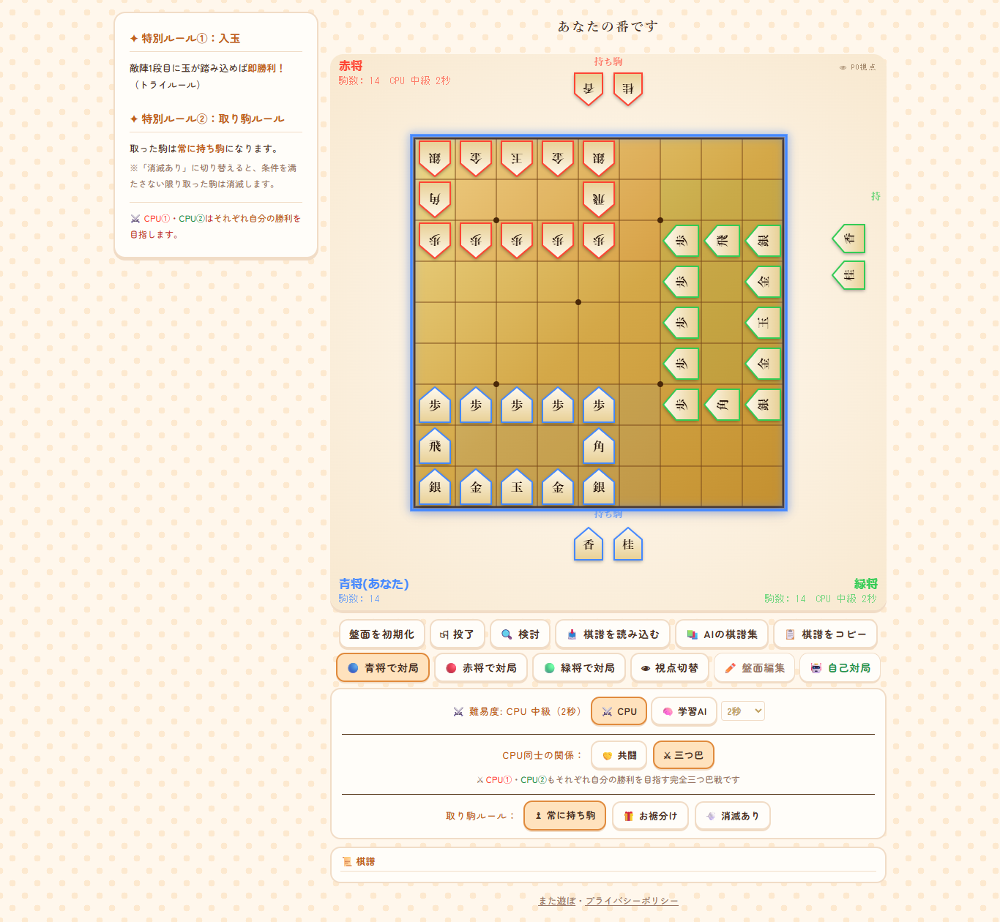
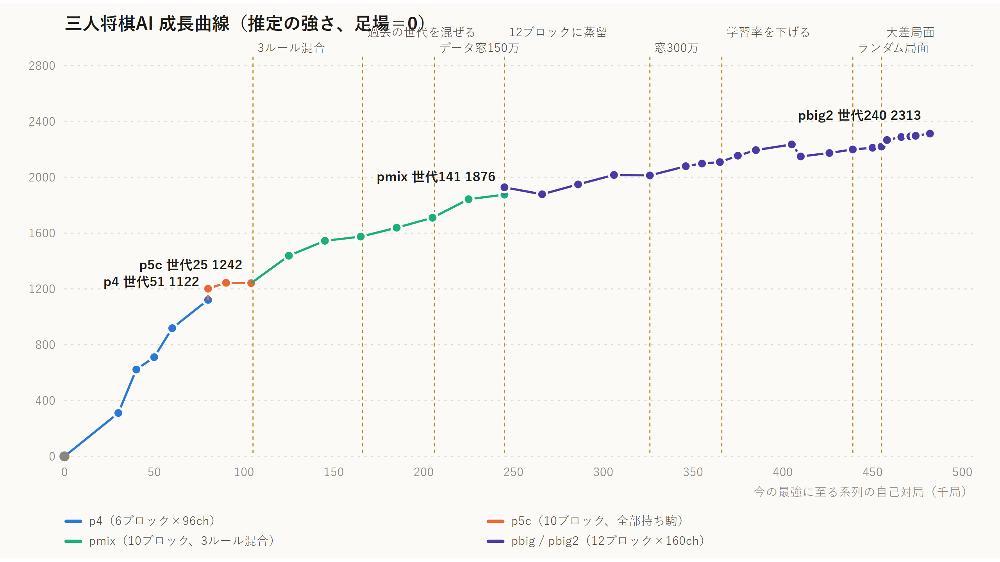
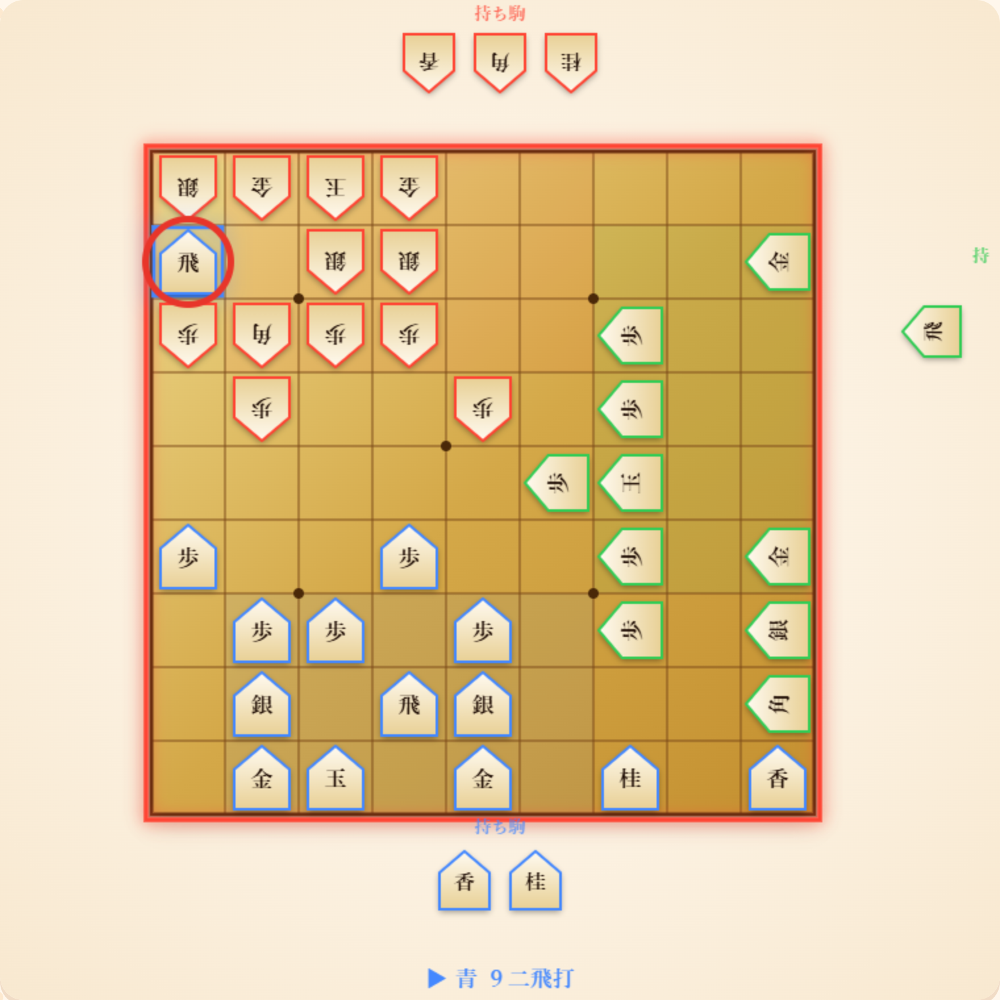
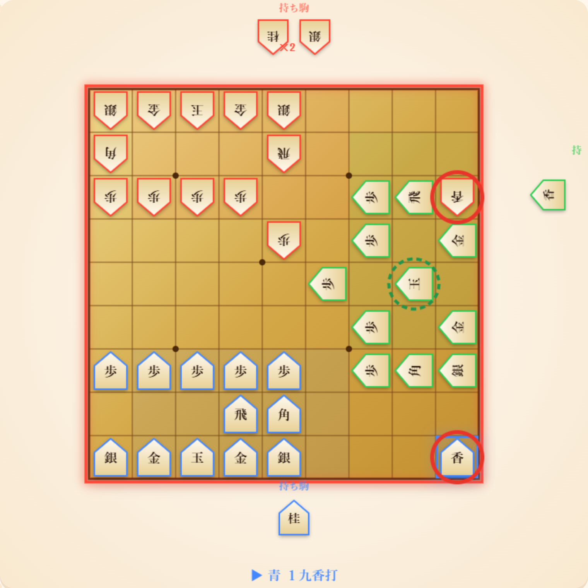

3人で1つの盤を囲む「三人将棋」を作り、そのAIを、ルールと勝ち負けだけから自己対局で学習させました。AlphaZero / KataGo と同じ方式です。

できたAIはブラウザだけで動きます。ともだちと部屋を作って3人で指すこともでき、空いた席にはこのAIが入ります。

- 遊ぶ：https://mataasobo.com/shogi3/
- ともだちと指す：https://mataasobo.com/shogi3/room.html
- コード・学習の記録：https://github.com/sphosino/shogi3

この記事では、学習で詰まったところと、AIが見つけた「人の感覚とちがう三人将棋の戦い方」を書きます。

## 三人将棋のルール

- 9×9の盤に、青（下から上へ）・赤（上から下へ）・緑（右から左へ）の3人。
- 1人の駒は 玉・金2・銀2・飛・角・歩5、持ち駒に香と桂。
- 玉を取られた人は脱落し、最後に残った1人が勝ち。もうひとつ、玉が敵陣の1段目に入れば、その場で勝ち（入玉）。
- 取った駒をどうするかは3つのルールから選びます（自分の持ち駒にする／残りのもう1人に渡す／条件をみたさないと消える）。

## なぜ手作りのAIをやめたか

最初は、駒の価値などを手で書いた評価関数と、α-β探索で作りました。しかし三人だと、探索のやり方に良い選択肢がありません。

- **パラノイド探索**：「相手2人が組んで自分を狙ってくる」と仮定して、2人用の探索にする。枝刈りは効くが、実際には相手どうしも争うので、判断がずれる。
- **max^N**：3人それぞれが自分の点を最大にする、と考える。こちらが正しいが、枝刈りがほとんど効かない。

読む深さを1つ増やしても、勝率は33%から41%くらいにしか伸びませんでした。評価関数の係数の調整も、1件あたり約75分かかります。そこで、自己対局で学習する方式に切り替えました。

## 作ったもの

| 部分 | 中身 |
|---|---|
| ルールと探索 | Rust。ブラウザ版の JavaScript のルールと、14万手を比べて完全に一致することを確かめた |
| ネット | PyTorch。残差ネット（最後は12ブロック×160チャンネル）、FP16 |
| つなぎ | PyO3 / maturin で Rust を Python から呼ぶ |
| マシン | RTX 3080（10GB）、i7-13700KF、メモリ32GB、Windows 11 |
| ブラウザ版 | 探索は WebAssembly、ネットの推論は ONNX Runtime Web（WebGPU、なければCPU） |

### 3人用のMCTS

AlphaZero の探索（PUCT）を、価値を「3人それぞれの勝率」の3つ組にして広げました。

- ネットは局面から「次の一手の確率」と「青・赤・緑それぞれが1位になる確率」を出す。
- 探索の各ノードでは、手番の人が自分の勝率が高い手を選ぶ。
- 葉の価値の3つ組は、そのまま根まで足す。2人ゲームのように符号を反転しない。

2人ゲームの「相手の得は自分の損」が成り立たないので、こうする必要があります。「2人に組まれる」と仮定しないので、パラノイドのずれもありません。

### 盤を回転させない

2人の将棋なら、手番の人から見た向きに盤を回してそろえられます。三人だと、手番の人をそろえても、残り2人の向きが席ごとに変わってしまいます。初期配置も3人で対称ではありません。なので盤は回さず、そのままの座標で入れて、「いま誰の番か」を入力で教えました。対称性を使ったデータの水増しもできません。

## 詰まったところ

### 1. 強化学習だけでは、駒の価値だけの足場にも勝てなかった

ネットがない最初の世代は、駒の価値だけで評価する簡単な探索（足場）で対局を作り、そこから強化学習を回しました。しかし数千局では、ネットが足場に追いつきません（足場に0〜8%）。

先に足場の対局を3万局作って、それを真似させる（蒸留）ことで、足場に75%勝つところから始められました。

### 2. 三人だと、価値が勝敗を丸暗記する

三人では序盤の勝ち負けに偶然が大きく、学習データの勝敗をそのまま覚えてしまいました。学習に使った対局では序盤でも勝敗を74〜81%当てるのに、まだ見ていない対局ではまったく当たりません。

価値の教師を「実際の勝者」と「探索の根の価値」の半々にすると、収まりました。大きいネットに移すときも、教師を「実際の勝敗」ではなく「先生ネットの出力」にすると、同じ局面にいつも同じ答えが返るので丸暗記が起きません。蒸留したネットが先生を超えました（先生に55%）。

### 3. 学習率をいきなり上げると、覚えたことが崩れる

蒸留の最後の学習率（0.002）から、強化学習をいきなり0.02で始めたら崩れました。蒸留直後の数世代だけ低くするようにしています。

### 4. 「誰を狙うか」の流行が巡回する

三人では、世代ごとに「誰の玉を狙うか」の流行が変わり、強さが一直線に並ばないことがありました（AはBに勝ち、BはCに勝ち、CはAに勝つ）。自己対局の25%に過去の世代を混ぜると、過去の流行への弱さが消えました。

### 5. 人が大差をつけると、AIがおかしくなる

AIどうしの対局では、20枚以上の駒の差がほとんど出ません（2万局に2局）。ところが人がAIと指して大差をつけると、AIにとって見たことのない局面になり、判断がおかしくなりました。実際に大差がついた局面や、ランダムな局面から指し直す対局を少し混ぜて、また強くなりました。

## 強さの伸び

駒の価値だけの足場を0として、直接対戦の勝率から積み上げた推定値で、最後のネットは約2,310です。12ブロック×160チャンネルでは頭打ちになったので、そこで止めました（v1.1）。

## AIが見つけた、人の感覚とちがう戦い方

ここがいちばん面白かったところです（数字は「取った駒は自分の持ち駒」ルールの自己対局から）。

### ただで取られる捨て駒を、よく指す

AIは序盤から、相手の玉のそばに大駒や香を打ちこみ、ただで取られるような手をよく指します。

*世代182の自己対局の46手目。青が赤の玉のそば（９二、赤丸）に飛車を打ち、次の手で赤が銀でただで取った。それでも青の勝率の予想は 36.1% → 36.7% で、ほとんど変わらない*

数えてみると、こうなっていました。

- 取られただけで終わっても、打った人の勝率の予想は平均1.5ポイント（飛車でも2.2ポイント）しか下がらない。
- 狙われた人を、もう1人も攻めに来る（同じ玉のそばに指す）割合が50〜57%。打ち合わせなしの「共闘」のように見える。
- 1局の中でこういう手を5回以上指した人の勝率は約43%、0回の人は約2%。ただし、強い局面だから攻められる、という逆向きの効果も混ざっている。

とくに謎なのが、**次に指す人にただで取られる場所**（打った人の駒も、3人目の駒も利いていないマス）にも打ってくることです。二人将棋なら、ただの損です。

そこで、AIの棋譜からこういう「次の人へのただ捨て」を60か所取り出して、今の学習AIに局面ごとに聞いてみました（1局面3200回読み）。

| 聞いたこと | ただ捨ての局面 | ふつうの局面 |
|---|---|---|
| 捨てない手を指したら、次の人は打った人を攻めるか | **47%** | 38% |
| 手番をそのまま3人目に渡したら、3人目は打った人を攻めるか | **22%** | 33% |
| 手番をそのまま3人目に渡したら、3人目は次の人を攻めるか | 44% | 42% |

*強い世代（182以降）の対局から。割合は、AIが読んだ候補手のうち「攻める手」（相手の駒を取る、または相手の玉の2マス以内に指す手）に使った読みの割合*

- ただ捨てが出るのは、**捨てない手を指すと次の人に攻められやすい局面**で、しかも**3人目は打った人を狙っていない局面**でした。
- そして、AIの評価では、ただ捨てと捨てない手はほとんど同じでした（今のAIもただ捨てをいちばんに読む局面では、差は0.1ポイント）。

ここからの推測です。三人では、次の人に自由な1手を渡すと、自分が攻められるかもしれません。駒を1枚ただで取らせれば、その1手は「取る」に使われ、手番は自分を狙っていない3人目に回ります。AIにとっては、駒1枚の損と、次の人の1手を消す得が、ほぼ釣り合っているように見えます。

ただし、数は60か所と少なく、「攻める手」の決め方も大まかです。本当にそう読んでいるのかは、まだ確かめきれていません。

### 駒数で大きくリードしても、勝てない

トップが2位に12枚以上の差をつけた局面でも、その人の勝率は30%で、平均の33%と変わりませんでした。持ち駒を8枚以上独り占めしても26%です。最初に脱落する人は、たいていリードしていた人でした。リードした人は、残り2人から順番に攻められます。

### 席によって有利・不利がある

学習が進むにつれて、緑の勝率が下がりました（世代213で 青38%・赤42%・緑20%）。原因は、青と赤が序盤に緑の玉の筋（1筋）へ香を打ち、上下から挟むことでした。最初の20手で青と赤の両方が1筋に香を打つ対局が62〜75%あります。手番の順番を変えても直らないので、初期配置の問題です。

*世代182の自己対局の10手目。赤が１三、青が１九に香（赤丸）。緑の玉（点線）はこれを嫌って、3手目にはもう１五から２五へ逃げている*

チェスでも囲碁でも、強い人どうしになるほど先手の有利がはっきりしてきました。三人将棋でも、AIが強くなるにつれて緑の不利が見えてきた、ということだと思います。

## ブラウザで動かす

学習したネットを ONNX にして、ブラウザの ONNX Runtime Web（WebGPU）で推論し、探索は Rust を WebAssembly にして動かしています。サーバーで推論しないので、遊ぶ人が増えても費用は増えません。GPU のない端末では、CPU で少し浅く読みます。

ともだちと指す部屋は Cloudflare Workers と Durable Objects で作りました。サーバーは指し手がルールどおりかを確かめて配るだけで、空いた席のCPUの手は、部屋にいる人のブラウザが学習AIで考えて送ります。

## おわりに

三人だと「2人用の常識」がいくつも通じず、学習のつまずき方も、AIの戦い方も、二人将棋とは別物でした。

AIと指すのも、ともだちと3人で指すのも、ブラウザで今すぐできます。感想や、AIに勝てた棋譜を送ってもらえるとうれしいです。

- 遊ぶ：https://mataasobo.com/shogi3/
- X：https://x.com/mataasobo_games
